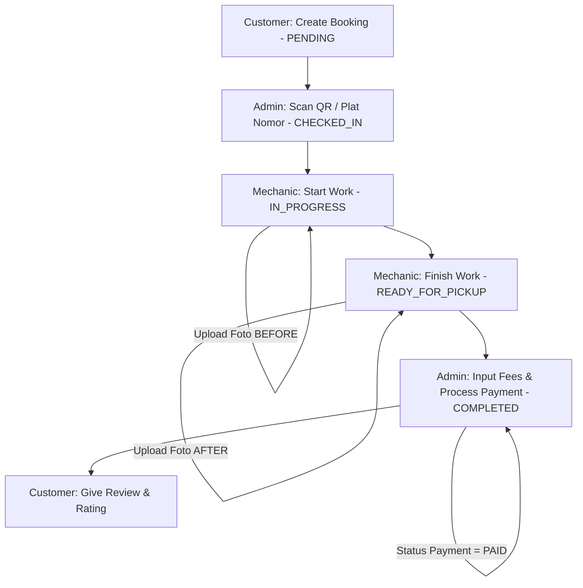

# Tallero Auto Repair Booking - API Documentation for Frontend (FE) Team

Dokumentasi ini dibuat untuk membantu tim Frontend mengintegrasikan aplikasi dengan REST API & WebSocket Realtime dari **Tallero Auto Repair Booking**.

---

## 1. Spesifikasi Umum

### Base URL
- **Local Development:** `http://localhost:5000/api`
- **Socket.io Connection:** `http://localhost:5000`
- **Static Files (Uploads):** `http://localhost:5000/uploads/[nama_file.ext]`

### Response Standard (JSend Format)
Semua response API menggunakan format **JSend** standar:

#### Response Sukses (200 OK / 201 Created)
```json
{
  "status": "success",
  "data": {
    "key": "value"
  }
}
```

#### Response Gagal (400 Bad Request / 422 Validation Error)
Status code `400` atau `422` jika input gagal divalidasi oleh Zod:
```json
{
  "status": "fail",
  "message": "Validation Error",
  "errors": [
    {
      "field": "email",
      "message": "Invalid email format"
    }
  ]
}
```

#### Response Error (401 Unauthorized / 403 Forbidden / 404 Not Found / 500 Internal Error)
Status code `4xx` atau `5xx` jika terjadi error sistem atau authorization:
```json
{
  "status": "error",
  "message": "Penjelasan detail mengenai error yang terjadi."
}
```

---

## 2. Autentikasi & Authorization

### Flow Registrasi & Aktivasi Akun
1. **POST `/auth/register`**: Registrasi user baru. User berstatus `isVerified: false` dan sistem mengirimkan 6-digit OTP ke email via Resend.
2. **POST `/auth/verify-otp`**: FE mengirimkan `email` dan `otpCode`. Jika sukses, user diaktifkan (`isVerified: true`) dan API mengembalikan JWT Bearer Token.
3. **POST `/auth/login`**: Login standard. User harus memiliki status `isVerified: true` dan `isActive: true`. API mengembalikan JWT token.

### Header Autentikasi
Untuk mengakses endpoint yang diproteksi (butuh login), FE harus melampirkan JWT di header `Authorization`:
```http
Authorization: Bearer <TOKEN_JWT_KAMU>
```

### Role System
Ada 3 role user:
- `CUSTOMER`: Membuat booking, review, chatbot consult, mendaftarkan kendaraan.
- `MECHANIC`: Membaca booking, mengubah status booking menjadi `IN_PROGRESS` atau `READY_FOR_PICKUP`, mengunggah foto pengerjaan.
- `ADMIN`: Mengelola outlet, service, user (CRM), memproses check-in QR, menyelesaikan pembayaran, serta melihat dashboard analitik.

---

## 3. Dokumentasi Endpoint API

### A. Authentication Module (`/auth`)

#### 1. Register Customer
- **Endpoint:** `POST /auth/register`
- **Request Body:**
  ```json
  {
    "name": "Budi Santoso",
    "email": "budi@example.com",
    "password": "securepassword123",
    "phone": "081234567890",
    "address": "Jl. Merdeka No. 10" // Opsional
  }
  ```

#### 2. Verify OTP (Aktivasi Akun)
- **Endpoint:** `POST /auth/verify-otp`
- **Request Body:**
  ```json
  {
    "email": "budi@example.com",
    "otpCode": "123456"
  }
  ```
- **Response Data (Success):** Mengembalikan `token` dan data `user`.

#### 3. Login
- **Endpoint:** `POST /auth/login`
- **Request Body:**
  ```json
  {
    "email": "budi@example.com",
    "password": "securepassword123"
  }
  ```

#### 4. Forgot Password (Kirim OTP Reset)
- **Endpoint:** `POST /auth/forgot-password`
- **Request Body:**
  ```json
  {
    "email": "budi@example.com"
  }
  ```

#### 5. Reset Password (Ganti Password Baru)
- **Endpoint:** `POST /auth/reset-password`
- **Request Body:**
  ```json
  {
    "email": "budi@example.com",
    "otpCode": "654321",
    "newPassword": "newsecurepassword456"
  }
  ```

#### 6. Get Current Profile
- **Endpoint:** `GET /auth/me`
- **Headers:** `Authorization: Bearer <token>`
- **Response Data:** Mengembalikan data detail user yang sedang login.

---

### B. Vehicle Module (`/vehicles`) - Authed
Digunakan customer untuk mengelola kendaraan yang ingin didaftarkan untuk servis.

#### 1. Dapatkan Kendaraan Saya
- **Endpoint:** `GET /vehicles/my`

#### 2. Tambah Kendaraan
- **Endpoint:** `POST /vehicles`
- **Request Body:**
  ```json
  {
    "licensePlate": "B 1234 ABC",
    "brand": "Toyota",
    "model": "Avanza",
    "type": "Car", // Default "Car"
    "year": 2020
  }
  ```

#### 3. Hapus Kendaraan
- **Endpoint:** `DELETE /vehicles/:id`

---

### C. Booking Module (`/bookings`) - Authed

#### 1. Create Booking (Customer)
- **Endpoint:** `POST /bookings`
- **Request Body:**
  ```json
  {
    "outletId": 1,
    "vehicleId": 2,
    "serviceId": 3,
    "bookingDate": "2026-08-25T10:00:00.000Z",
    "customerNotes": "Bunyi mendecit di bagian rem depan"
  }
  ```

#### 2. Get My Bookings (Customer)
- **Endpoint:** `GET /bookings/my`
- **Description:** List histori booking milik customer yang sedang login.

#### 3. Get All Bookings (Admin / Staff)
- **Endpoint:** `GET /bookings`
- **Query Params (Opsional):** `status` (PENDING, CHECKED_IN, dll), `outletId`, `search` (mencari berdasar bookingCode/nama customer/plat nomor).

#### 4. Get Booking Detail & Timeline Logs
- **Endpoint:** `GET /bookings/:id`
- **Response Data:** Mengembalikan data booking lengkap dengan log timeline (`statusLogs`), `photos` before/after, dan `review` jika sudah ada.

#### 5. Check-In via QR Code (Admin Only)
- **Endpoint:** `POST /bookings/check-in`
- **Request Body:**
  ```json
  {
    "bookingCode": "TLLR-1692800000000-456"
  }
  ```
- **Description:** Mengubah status booking dari `PENDING` menjadi `CHECKED_IN` saat plat nomor atau QR code diverifikasi di bengkel.

#### 6. Update Status Booking (Admin / Mechanic)
- **Endpoint:** `PUT /bookings/:id/status`
- **Request Body:**
  ```json
  {
    "status": "IN_PROGRESS", // Pilihan: CHECKED_IN, IN_PROGRESS, READY_FOR_PICKUP, COMPLETED, CANCELLED
    "adminNotes": "Mulai membongkar mesin dan mengganti oli."
  }
  ```
- **Description:** Mengubah status pengerjaan kendaraan. Jika diubah menjadi `READY_FOR_PICKUP`, sistem akan otomatis mengirim email notifikasi ke customer.

#### 7. Selesaikan Pembayaran (Admin Only)
- **Endpoint:** `PUT /bookings/:id/payment`
- **Request Body:**
  ```json
  {
    "paymentMethod": "QRIS", // Pilihan: CASH, TRANSFER, QRIS
    "serviceFee": 150000,
    "additionalFee": 50000,
    "totalPrice": 200000
  }
  ```
- **Description:** Menyelesaikan transaksi kasir. Otomatis mengubah status booking menjadi `COMPLETED` dan status pembayaran menjadi `PAID`.

#### 8. Upload Foto Sebelum/Sesudah Servis (Admin / Mechanic)
- **Endpoint:** `POST /bookings/:id/photos`
- **Headers:** `Content-Type: multipart/form-data`
- **Form Data (Multipart):**
  - `photo`: `[Pilih File Image (Max 5MB)]`
  - `type`: `BEFORE` atau `AFTER` (string)
  - `caption`: `Kondisi mesin awal berlumpur` (string, opsional)

#### 9. Get Timeline Logs (Tracking Kendaraan Real-Time)
- **Endpoint:** `GET /bookings/:id/logs`
- **Description:** Mendapatkan daftar logs history lengkap untuk membuat tracker timeline ala logistik kurir.

---

### D. Chatbot Konsultasi AI (`/chat`) - Authed
Frontend dapat memicu obrolan berbasis AI untuk membantu customer mendiagnosa kerusakan kendaraannya sebelum ke bengkel.

- **Endpoint:** `POST /chat`
- **Request Body:**
  ```json
  {
    "message": "Rem motor saya bunyi mencit saat direm mendadak, kira-kira kenapa ya?"
  }
  ```
- **Response Data:**
  ```json
  {
    "status": "success",
    "data": {
      "reply": "Bunyi mendecit biasanya disebabkan oleh kampas rem yang mulai aus atau kotoran yang menempel pada piringan cakram..."
    }
  }
  ```

---

### E. Dashboard Analytics (`/dashboard`) - Admin Only
Untuk visualisasi grafik admin dashboard.

- **Endpoint:** `GET /dashboard`
- **Response Data:**
  ```json
  {
    "status": "success",
    "data": {
      "totalBookingsThisYear": 120,
      "totalBookingsLastYear": 100,
      "bookingChangePercentage": "20.00",
      "totalRevenueThisYear": 45000000,
      "totalRevenueThisMonth": 4500000,
      "activeCustomers": 85,
      "totalOutlets": 3,
      "bookingStats": {
        "PENDING": 10,
        "IN_PROGRESS": 5,
        "COMPLETED": 105
      },
      "monthlyChartData": [
        { "month": 1, "totalTransactions": 10, "totalRevenue": 2500000 },
        { "month": 2, "totalTransactions": 15, "totalRevenue": 4000000 }
        // ... (sampai index ke-12)
      ],
      "topServices": [
        {
          "serviceId": 1,
          "name": "Tune Up & Ganti Oli",
          "price": 350000,
          "totalBookings": 45
        }
      ]
    }
  }
  ```

---

## 4. Panduan Integrasi untuk Tim Frontend

### A. Menyimpan Token JWT
Setelah login (`POST /auth/login`) atau verifikasi OTP (`POST /auth/verify-otp`), simpan `token` ke `localStorage` (Web) atau `SecureStore` (React Native):
```javascript
// Web integration
const loginUser = async (email, password) => {
  const res = await axios.post('http://localhost:5000/api/auth/login', { email, password });
  if (res.data.status === 'success') {
    localStorage.setItem('token', res.data.data.token);
    localStorage.setItem('user', JSON.stringify(res.data.data.user));
  }
};
```

### B. Integrasi Upload Foto Servis (React / Vue / React Native)
Karena endpoint `/bookings/:id/photos` memproses berkas fisik, Anda **harus** menggunakan `FormData`:

```javascript
const uploadBookingPhoto = async (bookingId, file, type, caption) => {
  const formData = new FormData();
  formData.append('photo', file); // 'photo' wajib sama dengan field name di multer
  formData.append('type', type);  // 'BEFORE' atau 'AFTER'
  formData.append('caption', caption);

  const token = localStorage.getItem('token');

  const response = await axios.post(
    `http://localhost:5000/api/bookings/${bookingId}/photos`, 
    formData,
    {
      headers: {
        'Content-Type': 'multipart/form-data',
        'Authorization': `Bearer ${token}`
      }
    }
  );
  return response.data;
};
```

### C. Koneksi Real-time WebSocket (Socket.io)
Gunakan library `socket.io-client` di sisi frontend untuk menerima notifikasi status servis secara langsung tanpa perlu melakukan polling berkala:

```javascript
import { io } from "socket.io-client";

const socket = io("http://localhost:5000");

// Saat tersambung
socket.on("connect", () => {
  console.log("Connected to Realtime Server via Socket ID:", socket.id);
});

// Mendengarkan Booking baru yang masuk (Untuk Dashboard Admin)
socket.on("new_booking_created", (data) => {
  console.log("Ada Booking Baru:", data);
  // data: { bookingId, bookingCode, customerName, service }
  alert(`Booking Baru masuk dari ${data.customerName}!`);
});

// Mendengarkan Perubahan Status Servis Kendaraan (Untuk Aplikasi Customer / Mechanic)
socket.on("booking_status_updated", (data) => {
  console.log("Status Servis Diperbarui:", data);
  // data: { bookingId, bookingCode, status }
  // Trigger update state atau tampilkan push notification local
});

// Mendengarkan saat Mechanic mengunggah foto pengerjaan
socket.on("booking_photo_uploaded", (data) => {
  console.log("Foto Baru Diupload:", data);
  // data: { bookingId, photoId, type }
});
```

---

## 5. Status Alur Booking (Workflow Diagram)


