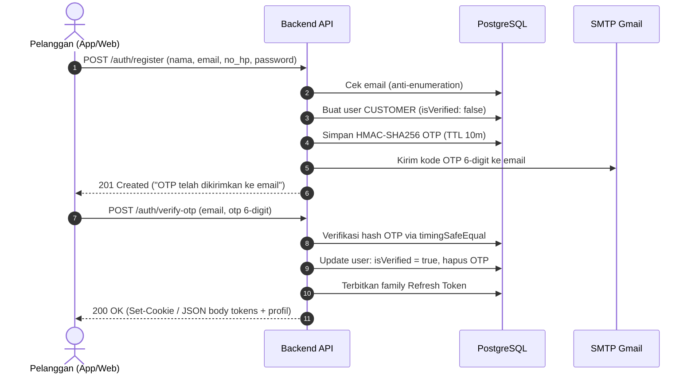
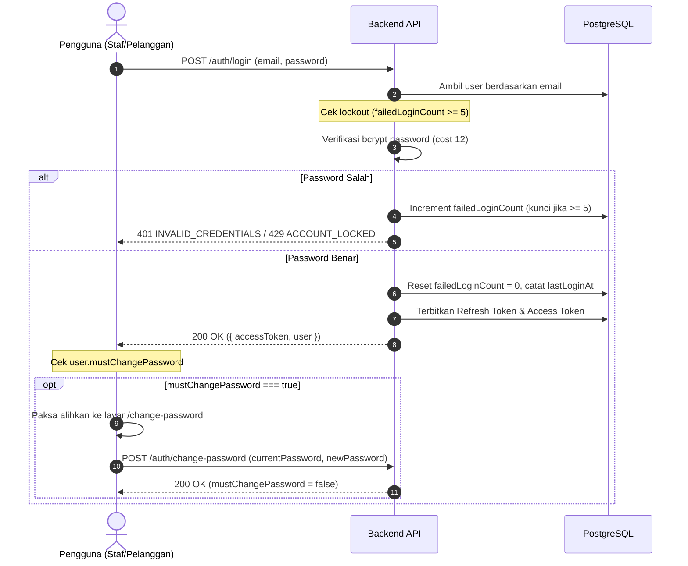
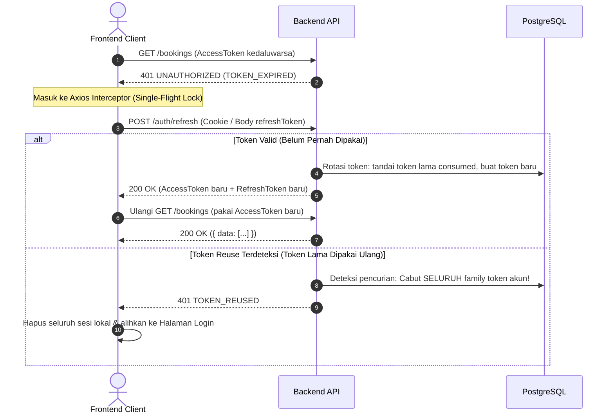

# TALLERO AUTO — ARSITEKTUR & PANDUAN ALUR AUTENTIKASI (AUTH_FLOW.md)

Dokumen ini menjelaskan secara terperinci implementasi autentikasi, manajemen sesi berbasis token, perbedaan perlakuan antara Klien Web dan Klien Mobile, rotasi token, serta penanganan error keamanan pada **Tallero Auto**.

---

## 1. Arsitektur Sesi Berbasis Token Ganda

Tallero Auto menggunakan kombinasi dua token untuk menjaga keseimbangan antara keamanan tinggi dan kenyamanan pengguna (*seamless user experience*):
1. **Access Token (JWT)**:
   - Masa berlaku: **15 menit** (`ACCESS_TTL = "15m"` / 900 detik).
   - Format: JSON Web Token ber-algoritma `HS256`.
   - Penyimpanan:
     - **Web**: Di memori JavaScript runtime (mis. React Context / state modul). **Dilarang disimpan di `localStorage` atau `sessionStorage`** guna mencegah pencurian data akibat celah XSS.
     - **Mobile**: Disimpan di penyimpanan terenkripsi OS via `expo-secure-store`.
2. **Refresh Token (Opaque Token)**:
   - Masa berlaku: **30 hari** (`REFRESH_TTL_DAYS = 30`).
   - Format: String acak kriptografis 48-byte (`crypto.randomBytes(48).toString("hex")`).
   - Di database: Hanya disimpan dalam bentuk **hash SHA-256**.
   - Setiap kali digunakan untuk me-refresh sesi, refresh token akan **dirotasi** (token lama hangus, diterbitkan token baru).

---

## 2. Perbedaan Implementasi: Web vs Mobile

| Karakteristik | Klien Web (React / Next.js) | Klien Mobile (Expo / React Native) |
|:---|:---|:---|
| **Header Identifikasi** | Wajib menyertakan header `X-Client: web` | Tidak menyertakan header `X-Client` |
| **Media Pengiriman Refresh Token** | Cookie HTTP-Only (`Path=/api/v1/auth`, `SameSite=Strict/Lax`, `Secure`, `HttpOnly`) | JSON Body: `{ "refreshToken": "..." }` |
| **Penyimpanan Refresh Token** | Ditangani otomatis oleh Web Browser (skrip JS tidak bisa membaca cookie) | Disimpan manual di `expo-secure-store` |
| **Konfigurasi HTTP Client** | `withCredentials: true` (Axios) atau `credentials: "include"` (Fetch) | Header `Authorization: Bearer <accessToken>` |
| **Endpoint Refresh Sesi** | `POST /auth/refresh` (tanpa body, browser menyertakan cookie) | `POST /auth/refresh` dengan payload body JSON |

---

## 3. Diagram Alur Autentikasi (Mermaid)

### 3.1. Alur Registrasi & Verifikasi OTP Pelanggan


---

### 3.2. Alur Login & Penanganan `mustChangePassword`


---

### 3.3. Alur Rotasi Refresh Token & Single-Flight Interceptor


---

## 4. Pola Interceptor Klien (Single-Flight Refresh)

Ketika token kedaluwarsa, beberapa request bersamaan bisa memicu kesalahan ganda jika masing-masing mencoba me-refresh token. Klien wajib mengimplementasikan antrean *single-flight refresh*:

Contoh implementasi standar Axios Interceptor:
```javascript
import axios from 'axios';

let isRefreshing = false;
let failedQueue = [];

const processQueue = (error, token = null) => {
  failedQueue.forEach(prom => {
    if (error) {
      prom.reject(error);
    } else {
      prom.resolve(token);
    }
  });
  failedQueue = [];
};

api.interceptors.response.use(
  response => response,
  async error => {
    const originalRequest = error.config;

    // Jika error 401 dan bukan dari endpoint refresh atau login
    if (error.response?.status === 401 && !originalRequest._retry && !originalRequest.url.includes('/auth/')) {
      if (isRefreshing) {
        // Antrekan request yang gagal sampai refresh selesai
        return new Promise((resolve, reject) => {
          failedQueue.push({ resolve, reject });
        }).then(token => {
          originalRequest.headers['Authorization'] = `Bearer ${token}`;
          return api(originalRequest);
        });
      }

      originalRequest._retry = true;
      isRefreshing = true;

      try {
        // Panggil endpoint refresh (Web memakai cookie, Mobile mengirim body)
        const res = await api.post('/auth/refresh', isMobile ? { refreshToken: getStoredToken() } : {});
        const newToken = res.data.data.accessToken;
        
        saveAccessToken(newToken);
        if (isMobile) saveRefreshToken(res.data.data.refreshToken);
        
        processQueue(null, newToken);
        originalRequest.headers['Authorization'] = `Bearer ${newToken}`;
        return api(originalRequest);
      } catch (refreshErr) {
        processQueue(refreshErr, null);
        clearAuthSession();
        window.location.href = '/login';
        return Promise.reject(refreshErr);
      } finally {
        isRefreshing = false;
      }
    }

    return Promise.reject(error);
  }
);
```

---

## 5. Matriks Penanganan Error Autentikasi untuk UI

| HTTP Status | `error.code` | Penyebab di Server | Rekomendasi Tindakan di UI |
|:---:|:---|:---|:---|
| **400** | `VALIDATION_ERROR` | Format email salah, password kurang dari 8 karakter, atau nomor telepon tidak sesuai regex. | Tampilkan pesan validasi tepat di bawah field input formulir. |
| **400** | `INVALID_OTP` | Digit OTP salah atau sudah lewat batas 10 menit. | Bersihkan input OTP, beri pesan "Kode OTP tidak valid atau kedaluwarsa". |
| **400** | `MAX_OTP_ATTEMPTS_EXCEEDED`| Salah memasukkan OTP 5 kali berturut-turut. Kode hangus. | Kunci input OTP, tampilkan tombol "Kirim Ulang OTP Baru". |
| **400** | `INVALID_RESET_TOKEN` | Token reset password dari email sudah pernah dipakai atau lewat dari 30 menit. | Tampilkan halaman error "Tautan tidak valid", sediakan tombol minta tautan baru. |
| **401** | `INVALID_CREDENTIALS` | Email atau password tidak cocok saat login. | Tampilkan peringatan merah "Email atau password yang Anda masukkan salah". |
| **401** | `UNAUTHORIZED` | Access token kedaluwarsa atau signature rusak. | Picu alur refresh token transparan di background. |
| **401** | `TOKEN_REUSED` | Token refresh lama digunakan ulang (indikasi dicuri). Seluruh sesi dicabut. | Bersihkan memori/storage lokal, tampilkan modal "Sesi Anda telah berakhir demi keamanan. Silakan login kembali". |
| **403** | `ACCOUNT_DEACTIVATED` | Akun dinonaktifkan oleh administrator. | Tampilkan pesan "Akun Anda telah dinonaktifkan. Hubungi admin cabang". |
| **403** | `PASSWORD_CHANGE_REQUIRED` | Staf baru login pertama kali (`mustChangePassword: true`). | Langsung alihkan layar ke formulir Ganti Password. Kunci menu navigasi lain. |
| **429** | `ACCOUNT_LOCKED` | Gagal login 5 kali berturut-turut. Akun dikunci selama 15 menit. | Nonaktifkan tombol login, tampilkan timer hitung mundur 15 menit. |
| **429** | `OTP_COOLDOWN_ACTIVE` | Menekan tombol kirim ulang OTP sebelum jeda 60 detik selesai. | Nonaktifkan tombol kirim ulang, tampilkan timer countdown 60 detik. |
| **429** | `OTP_MAX_SENDS_EXCEEDED` | Mencapai batas maksimal 5 kali kirim OTP dalam kurun waktu 1 jam. | Tampilkan peringatan "Batas pengiriman OTP tercapai. Coba lagi dalam 1 jam". |
| **502** | `EMAIL_DELIVERY_FAILED` | Gangguan koneksi ke gateway SMTP Gmail saat mengirimkan OTP / link reset. | Tampilkan notifikasi "Gagal mengirimkan email, silakan coba beberapa saat lagi". |

