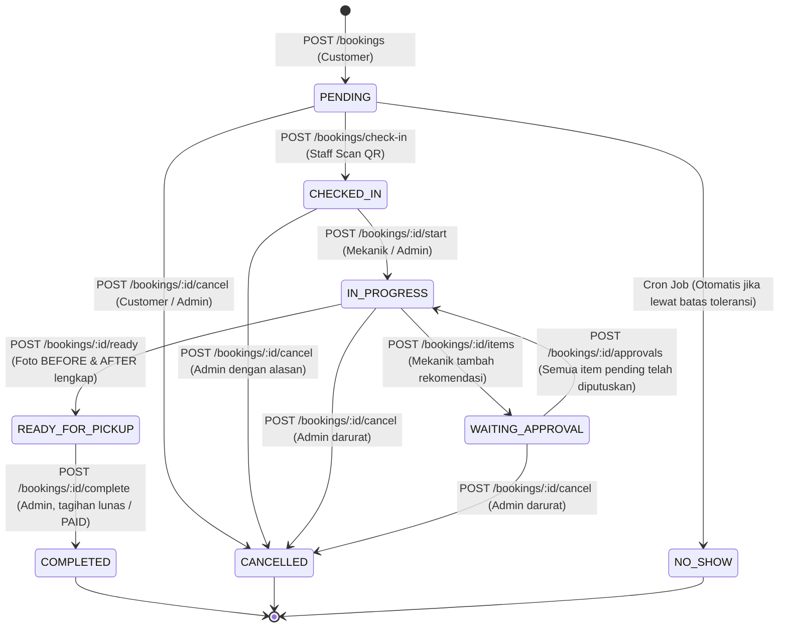

# TALLERO AUTO — ATURAN BISNIS & STATE MACHINE (BUSINESS_RULES.md)

Dokumen ini menjadi satu-satunya sumber acuan logika bisnis, aturan validasi siklus pengerjaan bengkel, dan konstanta numerik operasional bagi pengembang Frontend Web dan Mobile **Tallero Auto**.

---

## 1. State Machine Booking (Siklus Hidup Pengerjaan)

Semua perubahan status booking dikendalikan melalui satu gerbang pintu: `src/services/bookingStateMachine.service.js`. Perubahan status di luar alur ini dilarang keras dan akan menghasilkan respon **HTTP 409 INVALID_STATE_TRANSITION**.

### 1.1. Diagram Status Booking (Mermaid)

---

### 1.2. Tabel Transisi Status & Guard Validasi

| Dari Status | Ke Status | Aktor yang Berhak | Syarat / Guard Operasional | Efek Samping / Mutasi Database |
|:---|:---|:---|:---|:---|
| `[*] (Baru)` | `PENDING` | `CUSTOMER` | - Hari & jam buka valid - Waktu booking $\ge \text{now} + 60\text{m}$ - Waktu booking $\le \text{now} + 30\text{d}$ - Slot tidak `FULL` - Booking aktif customer $< 3$ - Kendaraan tidak sedang servis aktif | Simpan `Booking`, snapshot harga layanan di `BookingItem`, kunci slot kapasitas di bawah baris lock outlet. |
| `PENDING` | `CHECKED_IN` | `STAFF` (Mekanik/Admin) | - QR Code valid (HMAC lolos) - Tanggal hari-H (waktu lokal cabang) - Mulai dibuka pada $\text{scheduledAt} - 60\text{m}$ - Sebelum jam tutup cabang | Terbitkan `queueDate`, `queueNumber` (berurutan atomik), catat `checkedInAt`, `odometerKm`, dan evaluasi keterlambatan `isLate`. |
| `PENDING` | `CANCELLED` | `CUSTOMER` atau `ADMIN` | - Customer: Wajib sebelum $\text{scheduledAt} - 60\text{m}$ (`CANCEL_CUTOFF_MINUTES`) - Admin: Wajib menyertakan `reason` | Catat `cancelledAt`, `cancelledById`, `cancelReason`. Slot dikembalikan. |
| `PENDING` | `NO_SHOW` | `SYSTEM` (Cron Job) | $\text{now} > \text{slotEndAt} + 60\text{m}$ (`NO_SHOW_GRACE_MINUTES`) | Catat `BookingLog` sistem. |
| `CHECKED_IN` | `IN_PROGRESS` | `STAFF` (Mekanik/Admin) | - Booking merupakan kepala antrean (*queue head*) untuk mekanik tersebut - Mekanik sedang tidak menangani mobil lain (`MAX_ACTIVE_JOBS=1`) - Stok suku cadang untuk item yang disetujui mencukupi | Potong stok suku cadang bersyarat, kunci mekanik penangan `mechanicId`, catat `startedAt`. |
| `IN_PROGRESS` | `WAITING_APPROVAL`| `STAFF` (Penangan/Admin) | Ada minimal $\ge 1$ item rekomendasi tambahan berstatus `PENDING_APPROVAL` | Kirim notifikasi push & socket `APPROVAL_REQUEST` ke pelanggan. |
| `WAITING_APPROVAL` | `IN_PROGRESS` | `CUSTOMER` atau `ADMIN` | Seluruh item tambahan yang berstatus pending telah diputuskan (*approved* / *rejected*) | Hitung ulang `Booking.total`, potong stok item yang disetujui, kembalikan status pengerjaan. |
| `IN_PROGRESS` | `READY_FOR_PICKUP`| `STAFF` (Penangan/Admin) | - Minimal 1 foto inspeksi `BEFORE` dan 1 foto `AFTER` - Tidak ada item pending approval - Seluruh item telah dihitung totalnya | Catat `readyAt`, perbarui total tagihan akhir. Pelanggan kini dapat membayar via Midtrans Snap. |
| `READY_FOR_PICKUP` | `COMPLETED` | `ADMIN` (Kasir) | Tagihan booking telah lunas (`paymentStatus === "PAID"`) | Catat `completedAt`, terbitkan nomor faktur `invoiceNumber`, jadwalkan `ServiceReminder` otomatis (idempotent). |

---

## 2. Aturan Bisnis Terperinci

### 2.1. Slot & Kapasitas Bengkel
1. **Grid Waktu**: Slot dibagi rata per jam (`slotMinutes = 60`) dari `openTime` hingga `closeTime`.
2. **Kapasitas**: Jumlah mobil yang dapat dibooking per slot dibatasi oleh `slotCapacity` masing-masing cabang.
3. **Pencegahan Overbooking**: Saat membuat reservasi baru, backend mengunci baris database outlet bersangkutan (`SELECT id FROM outlets WHERE id = ... FOR UPDATE`) dalam transaksi atomik Prisma, menghitung ulang jumlah slot yang terisi, dan menolak dengan kode `SLOT_FULL` jika sisa kapasitas nol.
4. **Jarak Pemesanan**:
   - Paling cepat: 60 menit dari jam sekarang (`MIN_LEAD_MINUTES = 60`).
   - Paling lama: 30 hari ke depan (`MAX_ADVANCE_DAYS = 30`).

### 2.2. Antrean Pit & Mekanik (Anti-Menyelak)
1. **Nomor Antrean**: `queueNumber` diterbitkan berurutan mulai dari 1 setiap pergantian hari lokal cabang (`Asia/Jakarta`).
2. **Kepala Antrean (*Queue Head*)**:
   - Mekanik hanya diizinkan mengklaim atau memulai mobil yang berstatus `CHECKED_IN` dengan `queueNumber` terkecil di antara unit yang belum ditugaskan (`mechanicId IS NULL`) atau unit yang telah ditugaskan khusus untuk dirinya.
   - Upaya mengambil unit antrean di belakang akan ditolak dengan kode status **HTTP 409 QUEUE_ORDER_VIOLATION**.
3. **Batas Beban Mekanik**: Satu mekanik hanya boleh menangani 1 mobil aktif dalam status `IN_PROGRESS` atau `WAITING_APPROVAL` (`MAX_ACTIVE_JOBS_PER_MECHANIC = 1`).

### 2.3. Rekomendasi Item Tambahan & Persetujuan Pelanggan
1. **Harga Snapshot**: Harga unit yang dicatat pada `BookingItem` adalah harga resmi katalog pada saat item dibuat/disetujui. Perubahan harga master di kemudian hari tidak mempengaruhi transaksi yang sedang berjalan.
2. **Total Tagihan Server-Side**: `Booking.total` **selalu dihitung ulang di server** dari penjumlahan subtotal seluruh `BookingItem` yang berstatus `APPROVED`. Klien dilarang mengirimkan total harga sendiri.
3. **Persetujuan Batch**: Pelanggan memutuskan item perbaikan secara batch. Keputusan harus mencakup semua item pending. Admin dapat menyetujui atas nama pelanggan jika dihubungi via telepon, dengan kewajiban menyertakan catatan tertulis minimal 10 karakter yang dicatat di `AuditLog`.

### 2.4. Pembayaran Midtrans Snap & Kasir Tunai
1. **Penerbitan Token Snap**: Hanya dapat dilakukan jika booking telah berstatus `READY_FOR_PICKUP` dan tagihan berstatus `UNPAID`.
2. **Nominal Mutlak**: Nilai `gross_amount` yang dikirim ke Midtrans sama persis dengan `Booking.total` di database backend.
3. **Kedaluwarsa Pembayaran**: Sesi Snap aktif selama 60 menit (`PAYMENT_EXPIRY_MIN = 60`). Jika pelanggan membuat percobaan transaksi baru, transaksi pending sebelumnya otomatis dibatalkan di gerbang Midtrans.
4. **Pembayaran Kasir Tunai**: Kasir Admin mencatat pembayaran fisik yang diterima. Transaksi ini otomatis membatalkan token Snap yang menggantung dan mengubah `paymentStatus` menjadi `PAID`.
5. **Penanganan Transaksi Ganda (Duplicate Settlement)**: Jika terjadi pembayaran online yang masuk setelah kasir menyelesaikan booking secara tunai, transaksi ditandai sebagai `DUPLICATE`, tercatat di `AuditLog`, dan Admin diberi notifikasi untuk melakukan proses refund manual.

### 2.5. Uang Tip Apresiasi Mekanik
1. **Hak Penuh Mekanik**: Uang tip dicatat dengan `type = TIP` dan diarahkan ke `recipientMechanicId`. Tip **bukan pendapatan bengkel** dan dilaporkan terpisah dari omzet operasional.
2. **Batasan Nominal**: Minimal Rp 1.000 (`TIP_MIN`) dan maksimal Rp 500.000 (`TIP_MAX_PER_TRANSACTION`).
3. **Jendela Waktu**: Pelanggan hanya dapat memberikan tip dalam rentang 7 hari kalender setelah servis selesai (`TIP_WINDOW_DAYS = 7`).

### 2.6. Ulasan Pelanggan (Rating Servis)
1. **Syarat Pengisian**: Hanya pemilik kendaraan, status booking harus `COMPLETED`, dan hanya dapat mengisi 1 kali ulasan per booking.
2. **Jendela Waktu**: Maksimal 30 hari kalender setelah tanggal penyelesaian servis (`REVIEW_WINDOW_DAYS = 30`).
3. **Privasi Publik**: Ulasan yang ditampilkan ke publik hanya menampilkan nama depan pelanggan untuk menjaga kerahasiaan data pribadi.

### 2.7. Pengingat Servis Berkala (Service Reminders)
1. **Jadwal Otomatis**: Saat booking `COMPLETED`, backend memeriksa apakah layanan servis memiliki `reminderIntervalDays` (mis. 180 hari) atau `reminderIntervalKm` (mis. 10.000 km). Jika ada, `ServiceReminder` otomatis dijadwalkan secara idempotent.
2. **Pemicu Notifikasi**: Cron job harian yang berjalan pukul 08:00 WIB memeriksa pengingat yang memasuki H-7 (`REMINDER_LEAD_DAYS = 7`) dan memicu notifikasi push ke perangkat pelanggan.

---

## 3. Kamus Konstanta Bisnis Aktual (`src/config/rules.js`)

Nilai-nilai konstanta di bawah ini telah dikunci di backend dan wajib dijadikan acuan bagi Frontend Web & Mobile dalam menampilkan batas validasi form, timer countdown, dan badge peringatan:

| Nama Konstanta | Tipe | Nilai Aktual | Keterangan & Penggunaan di UI |
|:---|:---:|:---:|:---|
| `TIMEZONE` | string | `"Asia/Jakarta"` | Zona waktu dasar operasional bengkel (WIB, UTC+7). |
| `MIN_LEAD_MINUTES` | number | `60` | Minimal jarak pemesanan dari waktu saat ini (60 menit). |
| `MAX_ADVANCE_DAYS` | number | `30` | Batas maksimal pemesanan di muka (30 hari). |
| `CANCEL_CUTOFF_MINUTES` | number | `60` | Batas waktu pelanggan membatalkan booking sebelum jam slot. |
| `CHECKIN_EARLY_MINUTES` | number | `60` | Batas awal check-in diperbolehkan sebelum jam slot. |
| `NO_SHOW_GRACE_MINUTES` | number | `60` | Waktu toleransi sebelum booking dinyatakan NO_SHOW oleh cron. |
| `MAX_ACTIVE_BOOKINGS_PER_CUSTOMER` | number | `3` | Batas kuota booking berjalan per pelanggan. |
| `MAX_ACTIVE_JOBS_PER_MECHANIC` | number | `1` | Beban maksimal pengerjaan unit aktif per mekanik. |
| `MAX_PHOTOS_PER_TYPE` | number | `10` | Batas kuota foto inspeksi BEFORE dan AFTER (maks 10 foto/tipe). |
| `MAX_FILE_SIZE_BYTES` | number | `5242880` | Batas ukuran berkas upload gambar (5 MB). |
| `MAX_IMAGE_DIMENSION_PX` | number | `1920` | Resolusi sisi terpanjang kompresi WebP gambar. |
| `TIP_MIN` | number | `1000` | Batas nominal tip minimum (Rp 1.000). |
| `TIP_MAX_PER_TRANSACTION` | number | `500000` | Batas nominal tip maksimum (Rp 500.000). |
| `TIP_WINDOW_DAYS` | number | `7` | Batas hari pemberian tip setelah servis selesai. |
| `REVIEW_WINDOW_DAYS` | number | `30` | Batas hari pemberian ulasan setelah servis selesai. |
| `OTP_TTL_MIN` | number | `10` | Masa berlaku kode OTP verifikasi (10 menit). |
| `OTP_MAX_ATTEMPTS` | number | `5` | Batas maksimal kesalahan input OTP sebelum hangus. |
| `OTP_RESEND_COOLDOWN_SEC` | number | `60` | Jeda waktu countdown kirim ulang OTP (60 detik). |
| `OTP_MAX_SENDS_PER_HOUR` | number | `5` | Batas maksimal pengiriman OTP dalam 1 jam per user. |
| `LOGIN_MAX_FAILS` | number | `5` | Batas toleransi salah password sebelum akun dikunci. |
| `LOCK_MINUTES` | number | `15` | Durasi lockout akun saat salah password 5x (15 menit). |
| `BCRYPT_SALT_ROUNDS` | number | `12` | Cost hashing password dengan algoritma bcrypt. |
| `ACCESS_TTL` | string | `"15m"` | Masa aktif JWT Access Token (15 menit). |
| `ACCESS_TTL_SEC` | number | `900` | Durasi Access Token dalam satuan detik (900 detik). |
| `REFRESH_TTL_DAYS` | number | `30` | Masa aktif Refresh Token sesi (30 hari). |
| `SIGNED_URL_TTL_SEC` | number | `600` | Masa berlaku signed URL gambar privat (10 menit / 600 detik). |
| `PASSWORD_RESET_TTL_MIN` | number | `30` | Masa berlaku tautan email reset password (30 menit). |
| `PAYMENT_EXPIRY_MIN` | number | `60` | Masa berlaku sesi pembayaran Snap Midtrans (60 menit). |
| `REMINDER_LEAD_DAYS` | number | `7` | Jadwal notifikasi pengingat sebelum tanggal jatuh tempo (H-7). |
| `REPORT_MAX_RANGE_DAYS` | number | `366` | Batas rentang tanggal ekspor laporan admin (maksimal 1 tahun). |
| `LOW_STOCK_THRESHOLD` | number | `5` | Ambang batas peringatan stok suku cadang menipis ($\le 5$ pcs). |

