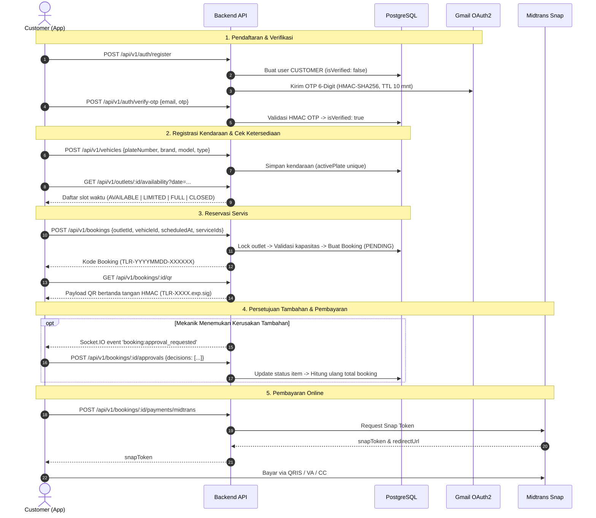
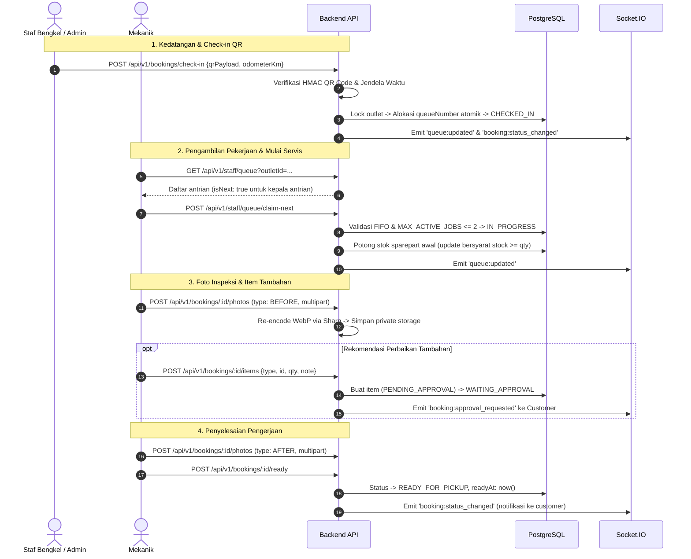
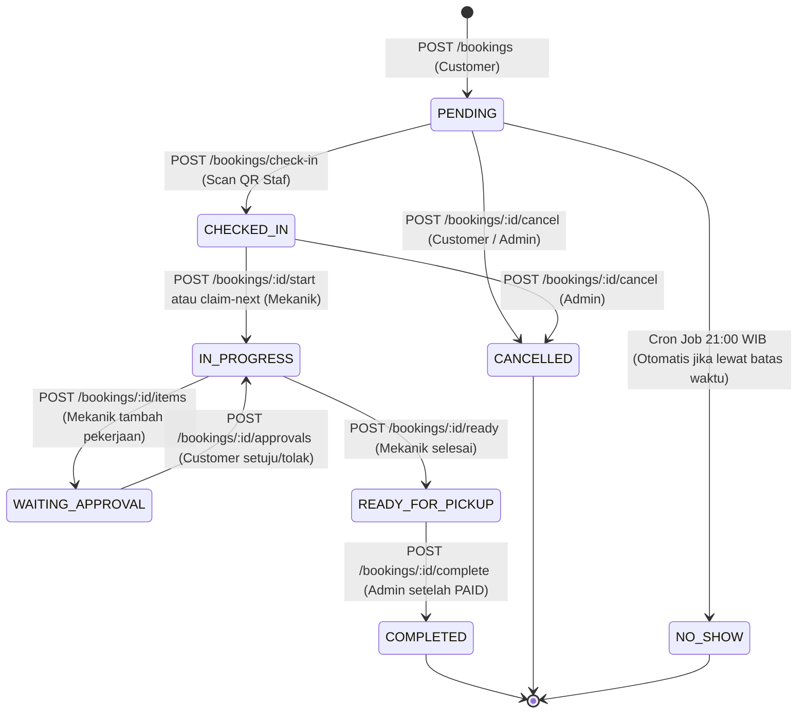
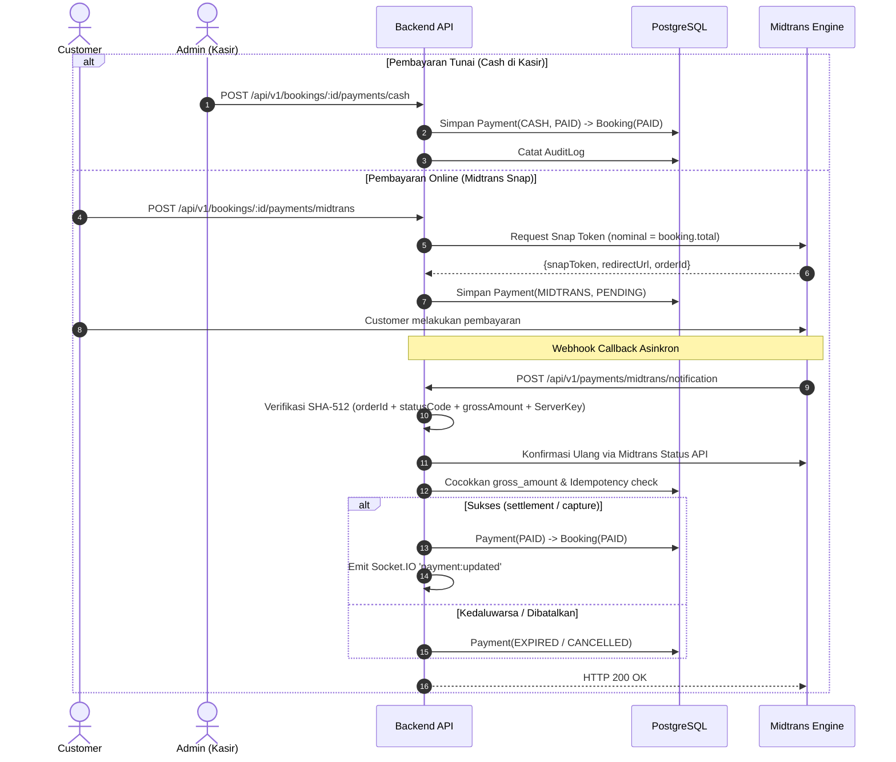
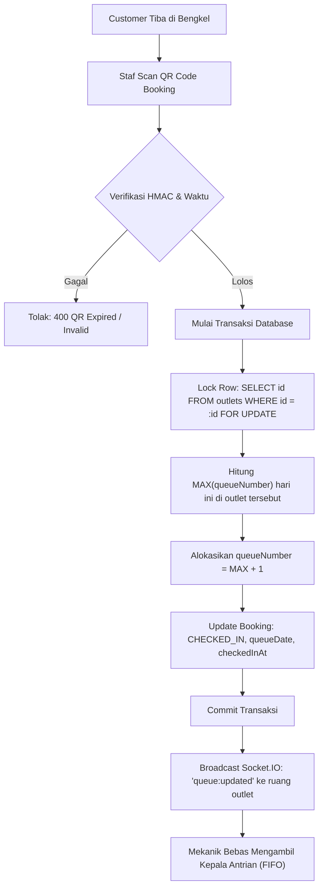
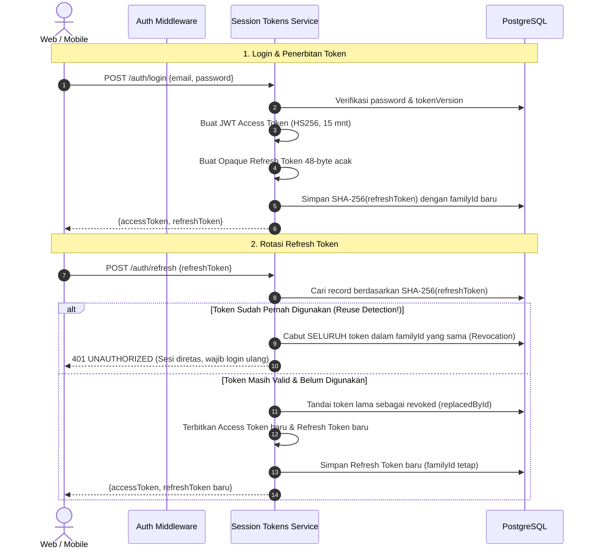

# TALLERO AUTO — WORKFLOW & ARCHITECTURE FLOWS

Dokumentasi diagram visual arsitektur alur kerja bengkel **Tallero Auto** untuk tim **Web Admin (React/Vite)** dan **Mobile Apps (Expo/React Native)**.

---

## 1. Alur Perjalanan Pelanggan (Customer Journey)

---

## 2. Alur Operasional Staf Bengkel (Staff & Workshop Flow)

---

## 3. State Machine Siklus Hidup Booking

Semua perubahan status booking wajib melalui mesin status terpusat dengan update bersyarat (`WHERE id = :id AND status = :fromStatus`):

---

## 4. Alur Pembayaran & Rekonsiliasi Webhook Midtrans

---

## 5. Alur Antrian Harian & Row Locking

---

## 6. Alur Autentikasi & Rotasi Sesi Token

