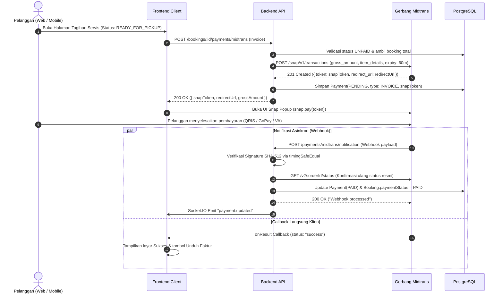

# TALLERO AUTO — INTEGRASI PEMBAYARAN MIDTRANS & KASIR (PAYMENTS.md)

Dokumen ini menjelaskan alur lengkap pemrosesan pembayaran online melalui gerbang pembayaran **Midtrans Snap**, pembayaran tunai di kasir bengkel, pemberian tip mekanik, faktur PDF, serta tata cara pengujian lingkungan *Sandbox* dan webhook lokal pada **Tallero Auto**.

---

## 1. Alur Transaksi Midtrans Snap End-to-End

Arsitektur pembayaran di backend Tallero Auto mengintegrasikan Midtrans Snap secara langsung via protokol HTTP murni dengan autentikasi Basic Auth (tanpa dependensi SDK lawas).

### Diagram Alur Pembayaran Online (Mermaid)



---

## 2. Status Transaksi Midtrans & Artinya bagi UI

| Status di Database | Status Midtrans | Arti Operasional | Panduan Tampilan UI |
|:---|:---|:---|:---|
| `PENDING` | `pending` | Transaksi telah dibuat, menunggu pelanggan membayar. | Tampilkan tombol "Lanjutkan Pembayaran" atau hitung mundur 60 menit. |
| `PAID` | `settlement` / `capture` (fraud: `accept`) | Dana telah sukses diterima dan diverifikasi resmi. | Tampilkan badge hijau **"LUNAS"**, buka tombol **"Unduh Faktur PDF"**. |
| `FAILED` | `deny` / `failure` | Pembayaran ditolak oleh bank penerbit atau algoritma fraud. | Tampilkan pesan merah "Pembayaran gagal, silakan gunakan metode pembayaran lain". |
| `EXPIRED` | `expire` | Waktu pembayaran telah melampaui batas 60 menit. | Tampilkan pesan "Sesi pembayaran telah kedaluwarsa", sediakan tombol "Bayar Ulang". |
| `CANCELLED` | `cancel` | Transaksi dibatalkan (karena ada transaksi baru atau dibayar tunai). | Transaksi lama tidak dapat dilanjutkan. |
| `DUPLICATE` | `settlement` (setelah booking `PAID`) | Terjadi pembayaran online susulan padahal booking sudah lunas (mis. dibayar tunai di kasir). | Tampilkan info "Pembayaran terdeteksi ganda, tim bengkel akan segera menghubungi untuk pengembalian dana". |

---

## 3. Pembayaran Tunai Kasir (`POST /bookings/:id/payments/cash`)

1. **Hak Akses**: Hanya dapat dieksekusi oleh pengguna dengan role **`ADMIN`**.
2. **Aturan Server-Side**:
   - Memvalidasi bahwa tagihan masih berstatus `UNPAID`.
   - Nominal pembayaran tunai otomatis disamakan secara mutlak dengan `Booking.total` dari database (kasir tidak menginput nominal bebas).
   - Membatalkan transaksi Snap Midtrans yang sedang pending via Midtrans Cancel API agar pelanggan tidak membayar online secara bersamaan.
   - Mencatat `receivedById = actor.id`, mengubah status pembayaran booking menjadi `PAID`, dan mencatatnya ke dalam `AuditLog`.

---

## 4. Uang Tip Apresiasi Mekanik (`POST /bookings/:id/tips`)

1. **Tujuan**: Memberikan apresiasi sukarela kepada mekanik penangan mobil.
2. **Karakteristik Finansial**:
   - Dicatat dengan `type = TIP` dan terikat pada `recipientMechanicId`.
   - **Bukan merupakan omzet atau pendapatan bengkel** (100% hak mekanik).
3. **Batasan Validasi**:
   - Nominal: Minimal **Rp 1.000** (`TIP_MIN`) dan maksimal **Rp 500.000** (`TIP_MAX_PER_TRANSACTION`).
   - Batas Waktu: Maksimal **7 hari** setelah servis selesai (`TIP_WINDOW_DAYS = 7`).
   - Mekanik: Booking wajib telah ditugaskan kepada mekanik tertentu (`mechanicId` tidak boleh kosong).

---

## 5. Unduhan Faktur PDF (`GET /bookings/:id/invoice.pdf`)

- **Syarat**: Booking harus sudah berstatus **`PAID`**. Upaya mengunduh faktur untuk booking yang belum lunas akan menghasilkan error **HTTP 409 BOOKING_NOT_PAID**.
- **Header Tanggapan**:
  - `Content-Type: application/pdf`
  - `Content-Disposition: attachment; filename="invoice-TLR-20261120-X8J2K1.pdf"`
- **Cara Penanganan di Frontend Web (Blob Download)**:
  ```javascript
  const downloadInvoice = async (bookingId) => {
    const response = await api.get(`/bookings/${bookingId}/invoice.pdf`, {
      responseType: 'blob'
    });
    
    // Buat URL sementara untuk trigger unduhan browser
    const blobUrl = window.URL.createObjectURL(new Blob([response.data], { type: 'application/pdf' }));
    const link = document.createElement('a');
    link.href = blobUrl;
    link.setAttribute('download', `invoice-booking-${bookingId}.pdf`);
    document.body.appendChild(link);
    link.click();
    link.remove();
    window.URL.revokeObjectURL(blobUrl);
  };
  ```

---

## 6. Tata Cara Pengujian Sandbox & Webhook Lokal

### 6.1. Kartu & Nomor Pembayaran Uji Coba Sandbox Midtrans
Gunakan kredensial pengujian berikut pada UI Snap Midtrans Sandbox:
- **Metode Pembayaran**:
  - **BCA Virtual Account**: `70012` + 11 digit bebas (mis. `7001200000000001`).
  - **BNI Virtual Account**: `988` + nomor bebas.
  - **Kartu Kredit Uji Coba**:
    - Nomor Kartu: `4811 1111 1111 1114`
    - Masa Berlaku: Bulan & Tahun masa depan (mis. `12/28`)
    - CVV: `123`
    - OTP Simulator: `112233`
  - **QRIS Sandbox**: Unduh gambar QR simulator dan lakukan simulasi bayar di simulator Midtrans:
    `https://simulator.sandbox.midtrans.com/qris/index`

---

### 6.2. Pengujian Webhook di Localhost
Karena server Midtrans tidak dapat mengirim request webhook ke alamat `localhost:5000` di mesin dev Anda:

#### Opsi A: Menggunakan Ngrok (Rekomendasi)
1. Buka terminal baru dan jalankan:
   ```bash
   npx ngrok http 5000
   ```
2. Salin alamat URL HTTPS yang dihasilkan (mis. `https://a1b2c3d4.ngrok-free.app`).
3. Buka Dashboard **Midtrans Merchant Portal** (Sandbox) $\rightarrow$ **Settings** $\rightarrow$ **Configuration**.
4. Masukkan Notification URL:
   `https://a1b2c3d4.ngrok-free.app/api/v1/payments/midtrans/notification`
5. Simpan pengaturan. Kini setiap pembayaran di sandbox akan otomatis diteruskan ke backend lokal Anda.

#### Opsi B: Pemicuan Manual via Endpoint Sync
Jika koneksi internet atau ngrok bermasalah saat dev, Admin dapat memicu sinkronisasi manual status transaksi menggunakan endpoint:
`POST /api/v1/payments/:orderId/sync`
Backend akan secara langsung menghubungi Midtrans Status API dan memperbarui database.

